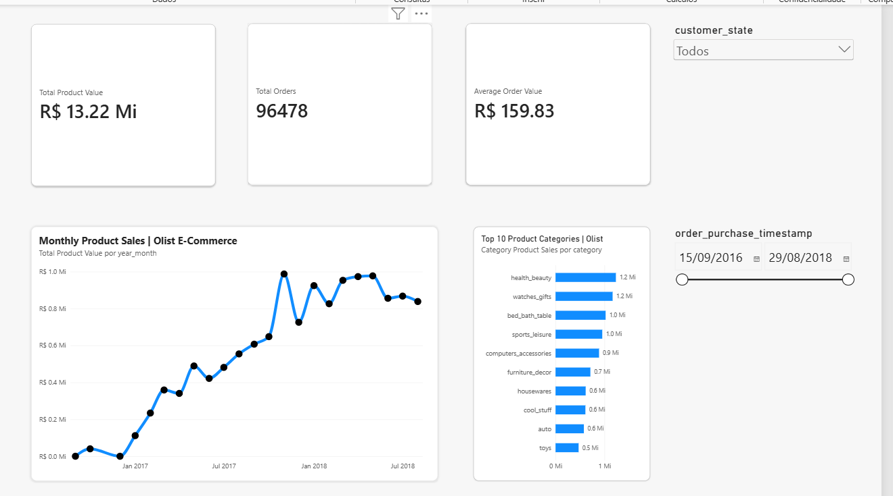
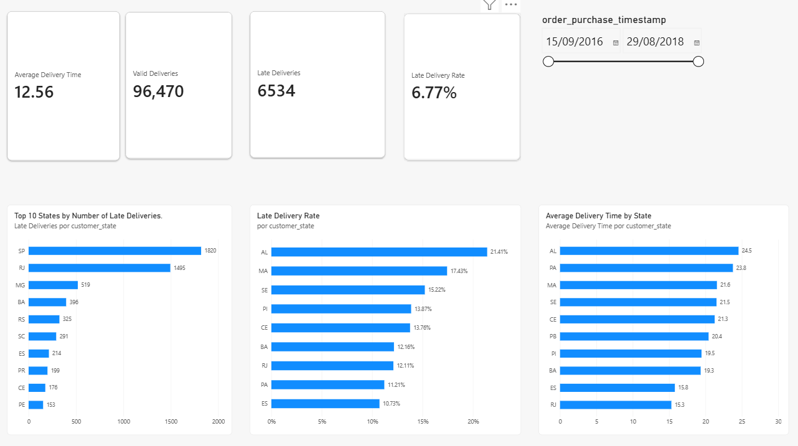
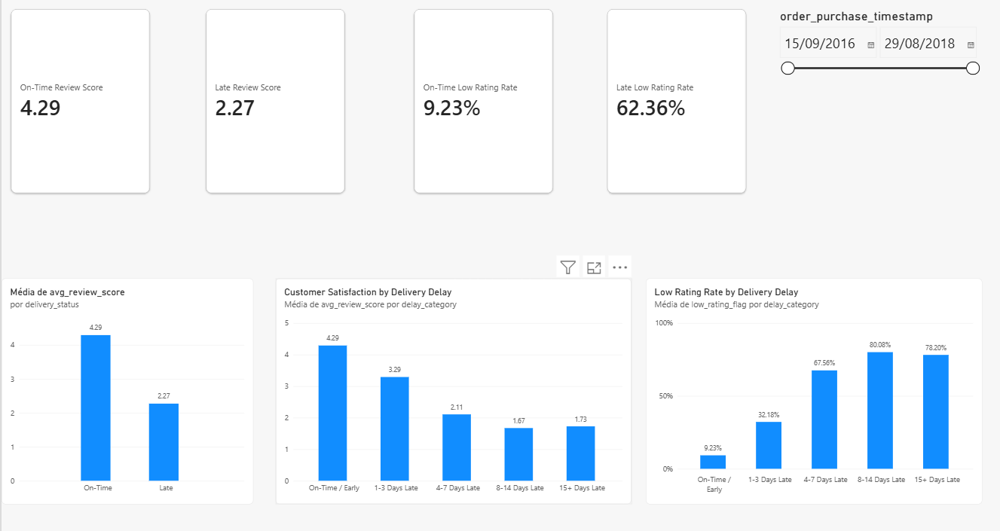

# Olist E-Commerce Analytics

**End-to-End Data Analytics Portfolio Project** | Python · Pandas · Jupyter · Power BI · Power Query · DAX

## Project overview

An exploratory and business intelligence analysis of the **Brazilian E-Commerce Public Dataset by Olist**. The project examines delivered-product sales, delivery efficiency, customer satisfaction, and data quality. Nine related source CSVs were consolidated into two Power BI-ready datasets and used to build three interactive dashboard pages.

**Business questions**
- What is the delivered-product sales value and which categories lead?
- Which Brazilian states contribute the most late deliveries, and which have the highest delay rates?
- How do customer review scores vary with delivery performance?
- Which source-data limitations affect interpretations and dashboard reliability?

## Key results

| Metric | Recorded result | Definition |
|---|---:|---|
| Delivered orders | 96,478 | Orders with `order_status == delivered` |
| Product value | R$ 13,221,498.11 | Sum of delivered line-item `price`, excluding shipping |
| Freight value | R$ 2,198,275.64 | Sum of delivered line-item freight charges |
| Average order value | R$ 159.83 | Average (item prices + freight) per delivered order |
| Deliveries with valid duration | 96,470 | Delivered orders with purchase and actual delivery timestamps |
| Average delivery time | 12.56 days | Elapsed days from purchase to delivery |
| Late deliveries | 6,534 | Actual delivery calendar date after estimated delivery date |
| Late delivery rate | 6.77% | Late deliveries / valid-duration deliveries |
| Average review (on time) | 4.29 / 5 | Mean order-level review score among reviewed on-time deliveries |
| Average review (late) | 2.27 / 5 | Mean order-level review score among reviewed late deliveries |
| Low-rating rate (on time) | 9.23% | Share of reviewed on-time orders with mean score ≤ 2 |
| Low-rating rate (late) | 62.36% | Share of reviewed late orders with mean score ≤ 2 |

These are historical descriptive results from the original notebook. On October 26, 2026, the project owner reran the optimized notebook locally and shared a screenshot confirming that its exported datasets matched the expected row counts, unique-order check, and aggregate product values. An independent rerun is still pending because the nine source CSVs were not provided with this package.

## Dashboard pages

1. **Sales Overview:** product value, delivered orders, average order value, monthly sales and top categories.
2. **Logistics Performance:** delivery time, late deliveries, late delivery rate and regional comparisons.
3. **Customer Satisfaction:** average review scores and low-rating rates across on-time and delayed deliveries.

The original Power BI Desktop report is included at `powerbi/Olist_Ecommerce_Analytics.pbix` **unchanged**. The three screenshots below were captured by the project owner in Power BI Desktop with the full date range selected. These images show the saved report's on-screen rendering, not a fresh independent execution of the underlying dataset or refresh.

### Sales Overview



**Business insight:** R$13.22 million in delivered-product value across 96,478 orders; health & beauty, watches & gifts, and bed, bath & table rank among the highest-value categories.

### Logistics Performance



**Business insight:** 6,534 late deliveries out of 96,470 deliveries with valid duration (6.77%). SP (1,820) and RJ (1,495) have the greatest *numbers* of late orders, while AL (21.41%) leads the *delay-rate* comparison. The visible rate chart includes nine qualifying states after applying the minimum-volume eligibility filter and the Top N ranking; this is a report-filter limitation, not evidence of a missing state.

### Customer Satisfaction



**Business insight:** The reviewed-order low-rating share was 9.23% for on-time delivery and 62.36% for late delivery. The 8–14-days-late group showed an 80.08% low-rating share. These are descriptive associations, not evidence that delays alone cause low ratings.

The image under `reports/validation/` documents the project owner's local notebook export check, rather than a dashboard page.

## Technical workflow

1. Load and inspect nine Olist CSVs using pandas.
2. Validate missing values and convert order timestamps.
3. Calculate elapsed delivery time and date-based delay indicators.
4. Analyze late-delivery volume and rates by customer state (minimum 100 deliveries for rate ranking).
5. Audit duplicate reviews and consolidate ratings by `order_id` before joining to orders.
6. Compare review scores and low-rating rates by delay bucket.
7. Aggregate item prices, freight and payment records by order for reconciliation.
8. Analyze monthly delivered-product sales, month-over-month growth and product categories.
9. Export one order-level dataset and one item-level dataset for Power BI.

### Important data-quality decisions

- **Review aggregation:** 99,224 review records map to 98,673 unique orders. Some orders have multiple or conflicting scores; the analysis averages scores at the order level rather than duplicating order rows.
- **Decimal precision:** `avg_review_score` may be fractional (e.g., 2.5). In Power Query, it must be imported as a decimal number, not an integer. An incorrect integer interpretation previously changed an on-time low-rating KPI from 9.23% to 9.26%; the decimal type restored the validated result.
- **Payment reconciliation:** 576 matched orders had a nonzero difference in integer cents between payment value and item-plus-freight value; 303 exceeded a **strict** R$ 0.01 threshold in the alternative comparison. This is an audit finding, not a determination of its cause.
- **Missingness:** 8 delivered orders lack a valid duration, 646 are missing review scores, and 1 has no payment record in the exported order-level dataset.
- **Category coverage:** 1,537 delivered line items have no original category (R$ 170,726.63 in product value). A further 22 items lack English translations but retain Portuguese category labels.

## Project structure

```text
Olist-Ecommerce-Analytics/
├── notebooks/
│   └── Olist_Ecommerce_Analysis_Portfolio.ipynb
├── data/
│   ├── raw/                    # Nine original Olist CSVs (download separately)
│   └── processed/              # Generated Power BI CSV exports
├── powerbi/
│   └── Olist_Ecommerce_Analytics.pbix   # Original saved report, unchanged
├── reports/
│   ├── figures/               # Notebook-generated plots
│   └── validation/
│       └── export_validation_local_2026-10-26.png
├── screenshots/
│   ├── sales_overview.png
│   ├── logistics_performance.png
│   └── customer_satisfaction.png
├── scripts/
│   └── validate_exports.py    # Read-only export and KPI checks
├── requirements.txt
├── .gitignore
├── CHANGELOG.md
├── POWER_BI_REVIEW.md
└── README.md
```

## How to run

1. Obtain the **Brazilian E-Commerce Public Dataset by Olist** from its original distribution source (commonly available on Kaggle). Verify the dataset's license and redistribution terms before publishing any raw CSVs.
2. Place the **nine original CSVs**, with their original filenames, in `data/raw/` (preferred). The notebook also detects a previously extracted `~/Downloads/archive/` folder. If neither applies, set `custom_data_dir` near the top of the notebook.
3. From the project root, install the dependencies: `python -m pip install -r requirements.txt`.
4. Start Jupyter with `jupyter lab` from the project root.
5. Open `notebooks/Olist_Ecommerce_Analysis_Portfolio.ipynb` and select **Run → Run All Cells**.
6. Confirm the `=== EXPORT VALIDATION ===` output displays **(96478, 15)** orders, **(110197, 7)** items, **0** duplicate orders and **True** for product values matching.
7. Run `python scripts/validate_exports.py` from the project root for additional **read-only** reconciliation checks on the two generated files.
8. Open the included `powerbi/Olist_Ecommerce_Analytics.pbix` in Power BI Desktop. If its data sources point to the original owner's `Downloads/archive/powerbi_export/` folder, update the query source paths to `data/processed/` before attempting a refresh. **Save any adjusted PBIX as a separate copy**; the report included here is the unchanged original.

The notebook also works when launched from inside `notebooks/`; its path configuration checks for that location. Raw CSVs are never overwritten by notebook code. The processed exports are regenerated in `data/processed/` on rerun, so preserve copies of earlier exports if comparing versions.

## Power BI model

- `orders_dashboard`: one row per delivered order; 96,478 rows and 15 exported columns in the original run.
- `order_items_dashboard`: one row per delivered order line item; 110,197 rows and 7 exported columns.
- Relationship: `orders_dashboard[order_id]` **1 → many** `order_items_dashboard[order_id]`, filtering from orders to items.
- Verify that review-score columns are decimal numbers and that the boolean `is_late` remains True/False.

## Validation checklist

- **Confirmed in project owner's local run (26 Oct 2026):** Orders `(96478, 15)`; items `(110197, 7)`; duplicate order IDs `0`; product-value equality `True` (screenshot supplied).
- **Previously cross-checked with Power BI:** displayed product value R$13.22 million; 96,478 orders; 6,534 late deliveries; 6.77% late rate; decimal review-score type correction restored the 9.23% low-rating result.
- **Checked from the supplied PBIX:** ZIP container integrity, presence of its embedded data model, three page definitions (Sales Overview, Logistics Performance, Customer Satisfaction), and 23 saved visual definitions. The PBIX was not opened in Power BI Desktop here, so interactive rendering, refresh and numerical measures were **not** independently executed.
- **Not independently checked in this package:** a notebook execution against the raw nine CSVs (not supplied) or a fresh Power BI Desktop refresh. **Owner-supplied screenshots for all three dashboard pages are now included** and their visible KPIs are consistent with previously cross-checked results.
- **To self-check processed outputs:** run `python scripts/validate_exports.py`. The script only reads files; it does not edit CSVs or notebooks.

## Business recommendations

- Investigate **SP and RJ**, which had the highest absolute counts of late deliveries.
- Review routing, carrier performance and ETA accuracy in high-delay-rate states such as **AL**.
- Introduce early communication for shipments likely to miss their estimated delivery date.
- Monitor review quality alongside delivery time and late-delivery rates to prioritize improvement efforts.

## Limitations

- Historical observational data do not establish causality or represent current company performance.
- Financial reconciliation differences and absent values require context before operational explanations can be assigned.
- Some views have different denominators, depending on whether delivery timestamps and reviews are available.
- The source dataset does not contain every dimension needed to identify the root causes of shipping delays.

## Portfolio status

The notebook has been reorganized for readability and portable data paths. **Notebook structure, Python syntax, and unchanged analytical code have been verified.** The project owner confirmed a local rerun on **October 26, 2026**, with evidence retained at `reports/validation/export_validation_local_2026-10-26.png`, confirming four export checks; that evidence does not replace independent verification of every KPI. The original `.pbix` report was subsequently provided and included **without modification**. Three owner-supplied full-page dashboard screenshots are now available in `screenshots/` and embedded above. Refer to `POWER_BI_REVIEW.md` for the PBIX structure audit and validation boundaries.


## Notebook maintenance

The final notebook removes redundant exploration and repeated imports. All business KPI calculations, aggregation logic, data-model joins and processed CSV export logic were retained. The published notebook retains saved historical outputs. The project owner has reported a local rerun and successful export checks. Users of the repository should rerun the notebook with their own source CSVs and check `scripts/validate_exports.py` for independent reproducibility.
